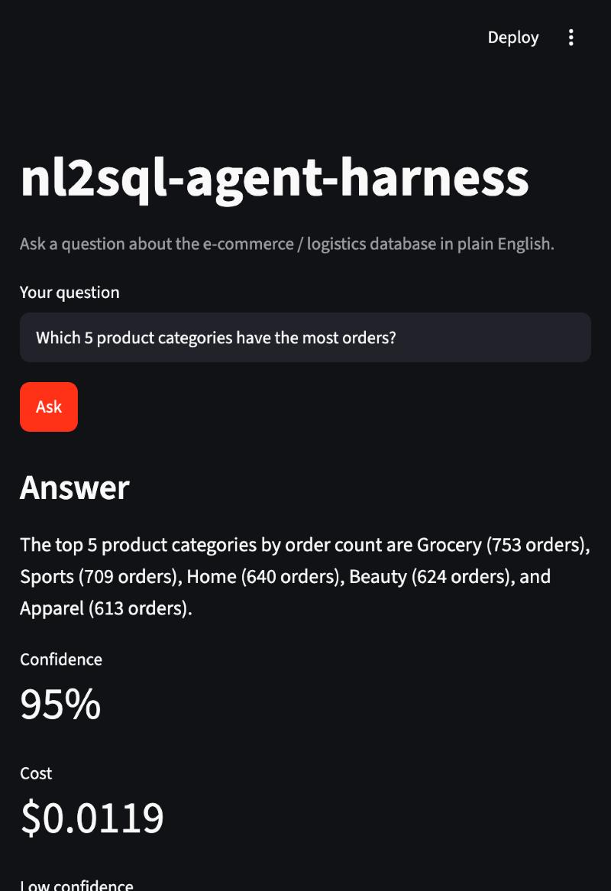
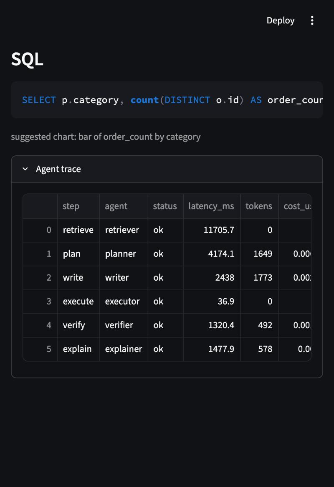
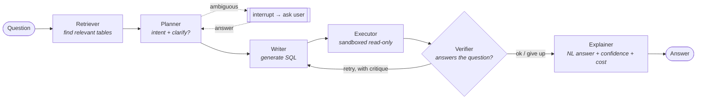
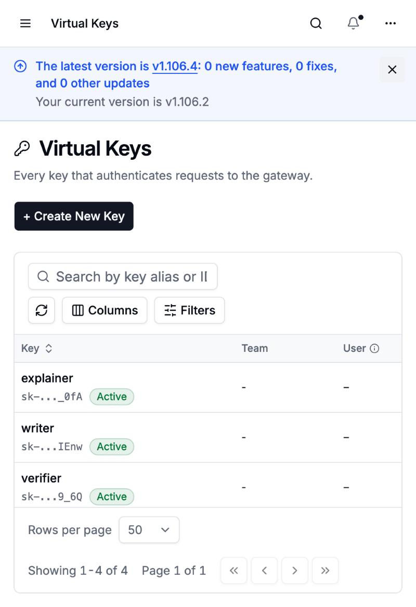
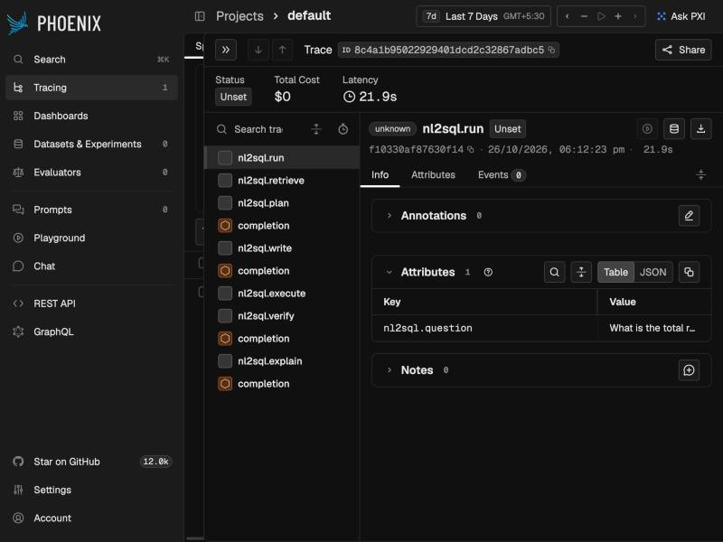

# nl2sql-agent-harness

**Ask a question about your data in plain English; get back a trustworthy answer, the SQL behind it, and a full trace of how the agents got there.**

`nl2sql-agent-harness` is a multi-agent **Text-to-SQL analytics agent** over an e-commerce / logistics
Postgres database. A small team of LLM "agents" (plan → write → execute → verify → explain) collaborate
in a self-correcting loop, backed by a sandboxed read-only SQL executor, retrieval over the database
schema, and the production plumbing you'd expect around a real agent: **evals that run in CI**,
**per-agent model routing and budgets**, **structured tool contracts**, **graceful failure handling**,
and **end-to-end observability**.

<p align="center">
  
  
</p>

> It's built as a portfolio-grade reference for **production agent engineering** — the emphasis is less
> on squeezing out the last accuracy point and more on everything that makes an agent *operable*:
> measured, routed, budgeted, sandboxed, observable, and honest about its own failures.

---

## How to read this README

This document goes from the big picture to the details. If you're skimming, the first few sections are
enough; each later section drills into one piece.

| Section | What you'll get |
|---|---|
| [What it does](#what-it-does) | The idea in plain English, and a worked example. |
| [Features at a glance](#features-at-a-glance) | A scannable list of everything that's built. |
| [Quick start](#quick-start) | Copy-paste commands to run the whole thing locally. |
| [How it works](#how-it-works) | The agent pipeline, step by step. |
| [Architecture](#architecture) | Components, the data model, and the LangGraph engine. |
| [The production-engineering story](#the-production-engineering-story) | Deep dives: evals-in-CI, routing & budgets, the SQL sandbox, resilience, observability, tool contracts. |
| [Surfaces](#surfaces-how-you-call-it) | The REST API, MCP server, and Streamlit UI. |
| [Project layout](#project-layout) | Where everything lives. |
| [Testing & evaluation](#testing--evaluation) | How correctness is measured and gated. |
| [Tech stack & status](#tech-stack) | Libraries, and what's done vs. planned. |
| [Further reading](#further-reading) | The deeper design docs. |

---

## What it does

You ask a question like *"Which 5 product categories have the most orders?"* and the system:

1. **Finds the relevant tables** by semantic search over the schema (you don't hand it the schema).
2. **Plans** what the query needs, and asks a clarifying question if the request is ambiguous.
3. **Writes** the SQL.
4. **Executes it safely** in a read-only sandbox (no query can ever modify data).
5. **Verifies** the result actually answers the question — and if not, **loops back and tries again**
   with the failure as feedback.
6. **Explains** the answer in plain English, and reports its **confidence** and the **dollar cost** of
   the run.

Every run produces a structured trace, so you can always see *why* you got the answer you did:

```
Question: "Which 5 product categories have the most orders?"
Answer:   "The top 5 are Grocery (753), Sports (709), Home (640), Beauty (624), Apparel (613)."
SQL:      SELECT p.category, count(DISTINCT o.id) AS order_count
          FROM orders o JOIN order_items oi ON oi.order_id = o.id
          JOIN products p ON p.id = oi.product_id
          GROUP BY p.category ORDER BY order_count DESC LIMIT 5
Confidence: 95%   Cost: $0.012
Trace:    retrieve → plan → write → execute → verify → explain   (each with latency, tokens, cost)
```

The data is a synthetic but realistic **e-commerce / logistics** database (sellers, products, customers,
orders, order_items, payments, refunds, couriers, shipments, …) generated deterministically with Faker,
so anyone who clones the repo gets the exact same numbers.

---

## Features at a glance

**The agent**
- 🧠 **Multi-agent self-correction loop** — Planner → Writer → Executor → Verifier → (retry ↺) → Explainer, orchestrated with **LangGraph** (typed state, reducers, conditional edges, checkpointing, interrupts).
- 🔎 **RAG schema-linking** — the agent retrieves the relevant tables/columns via **pgvector** similarity + foreign-key expansion, instead of being handed the whole schema.
- ❓ **Clarifying questions** — ambiguous questions pause the graph (`interrupt()`) and ask one question, then resume from a checkpoint.
- 💬 **Honest answers** — every answer carries a confidence score and degrades to a low-confidence answer rather than crashing or guessing.

**The production layer (the point of the project)**
- ✅ **Evals in CI** — a labelled question set is scored on **execution-match** and gated on a regression threshold in GitHub Actions. Runs **offline and deterministically** via recorded "cassettes" (no API key needed in CI).
- 🔀 **Model routing + per-agent budgets** — one Anthropic key behind a **LiteLLM** proxy; each agent gets its own **virtual key**, its own **model** (stronger for planning/verifying, cheaper for writing/explaining), and its own **spend budget**, visible in a live dashboard.
- 🛡️ **Sandboxed SQL executor** — three independent layers (SQL AST guard + read-only transaction + least-privilege DB role) make destructive queries impossible; an `EXPLAIN` cost gate blocks runaway queries.
- 🔁 **Resilience / failure handling** — bounded semantic retries, transient-error backoff, **provider fallback** (Claude → OpenAI), stage timeouts, and a documented catalogue of [failure modes](docs/FAILURE_MODES.md) each with a reproducing test.
- 🧰 **Typed tool contracts + permissions** — every tool has a strict Pydantic input schema and a permission matrix; the dangerous `run_sql` tool is **off by default**.
- 📊 **Observability** — OpenTelemetry traces → **Arize Phoenix**: one span per agent, LLM token/cost spans nested under each.
- 🧪 **Deterministic everything** — fixed seeds, `temperature=0`, positional tiebreak ordering, occurrence-indexed LLM cassettes, and a **pinned retrieved context** make offline runs byte-identical on any machine (so the eval gate is stable in CI).

**Surfaces**
- 🌐 **FastAPI** REST API · 🔌 **MCP server** (stdio + Streamable HTTP) · 🖥️ **Streamlit** UI.

---

## Quick start

**Prerequisites:** Docker Desktop, Python 3.11+, and an Anthropic API key (only needed for *live* runs —
the tests and evals run without one).

```bash
# 1. clone + configure
git clone <your-fork-url> nl2sql-agent-harness && cd nl2sql-agent-harness
cp .env.example .env                 # then put your ANTHROPIC_API_KEY in .env

# 2. bring up the stack: Postgres (+pgvector) + LiteLLM proxy + Phoenix
docker compose up -d

# 3. python environment
make venv

# 4. mint one budgeted, model-scoped LiteLLM virtual key per agent (writes them to .env)
make litellm-keys

# 5. load deterministic data + build the schema-embedding index
make seed
make index

# 6. run it
make api       # FastAPI        → http://localhost:8000  (/docs for Swagger)
make run       # Streamlit UI   → http://localhost:8501
make mcp       # MCP server over stdio   (make mcp-http for Streamable HTTP)
```

**Verify without spending anything** (offline, no API key):

```bash
make test      # 27 unit + cassette-replayed tests
make eval      # the eval harness → a scorecard in evals/report.md
```

Dashboards that come up with the stack:
- **LiteLLM admin UI** → http://localhost:4000/ui (login `admin` / your `LITELLM_MASTER_KEY`)
- **Arize Phoenix** (traces) → http://localhost:6006

> **Note:** on a pre-existing Postgres volume the `litellm` database isn't auto-created — run
> `make litellm-db` once before `make litellm-keys`. A fresh `docker compose up` creates it automatically.

---

## How it works

At the core is a loop of specialised agents. Each agent does one job and hands structured state to the
next; a **Verifier** decides whether the answer is good enough or the **Writer** should try again.



**Why separate Planner and Writer?** Planning (what tables, what measure, is it ambiguous?) and SQL
authoring are different skills with different failure modes. Splitting them lets each use a different
model and makes retries targeted — the Writer can be corrected by the Verifier without re-planning.

**The self-correction loop in one sequence:**

```mermaid
sequenceDiagram
    participant E as Engine
    participant W as Writer
    participant X as Executor
    participant V as Verifier
    loop until ok OR retry budget / wall-clock exhausted
        E->>W: write(plan, schema, previous critique?)
        W-->>E: SQL draft
        E->>X: execute(sql)  [read-only role, EXPLAIN gate, 1 SELECT, timeout]
        X-->>E: rows  /  structured error
        E->>V: verify(result vs. intent)
        V-->>E: ok | retry(+critique) | abort
    end
    E->>E: explain → answer + confidence + $cost; persist trace & checkpoint
```

If the loop runs out of retries or exceeds its time budget, it doesn't crash or loop forever — it
returns a clearly-marked **low-confidence** answer.

---

## Architecture

### Components

| Component | Responsibility | Lives in |
|---|---|---|
| **Orchestrator** | Runs the agent graph; owns retries, budgets, checkpoints. Pluggable behind a `Protocol`. | [`nl2sql/orchestration/`](nl2sql/orchestration/) |
| **Agents** | Planner / Writer / Verifier / Explainer — each a plain function `(state) → (result, usage)`. | [`nl2sql/agents/`](nl2sql/agents/) |
| **Retriever** | pgvector similarity over schema "cards" + exemplars + FK expansion. | [`nl2sql/retrieve.py`](nl2sql/retrieve.py) |
| **Executor (sandbox)** | Runs the SQL under three independent safety layers. | [`nl2sql/executor.py`](nl2sql/executor.py) |
| **SQL guard** | sqlglot AST check: single SELECT, no DML/DDL (even CTE-hidden), injects LIMIT + deterministic ORDER BY. | [`nl2sql/sqlguard.py`](nl2sql/sqlguard.py) |
| **LLM choke point** | The *only* place that calls a model: routing, cost accounting, structured output, cassettes. | [`nl2sql/llm.py`](nl2sql/llm.py) |
| **Telemetry** | OpenTelemetry → OTLP → Phoenix. | [`nl2sql/telemetry.py`](nl2sql/telemetry.py) |
| **Tool contracts** | Pydantic tool-input schemas + permission matrix. | [`nl2sql/tools/`](nl2sql/tools/) |
| **Surfaces** | FastAPI, MCP server, Streamlit — thin adapters over one shared core. | [`api/`](api/), [`mcp_server/`](mcp_server/), [`app/`](app/) |

### The data model

Two Postgres schemas on one database:
- **`shop`** — the analytics target the agent queries (11 tables: `sellers`, `products`, `customers`,
  `addresses`, `orders`, `order_items`, `payments`, `refunds`, `couriers`, `shipments`, `tracking_events`).
  The agent connects to this schema only through a **least-privilege read-only role** (`analyst_ro`).
- **`app`** — the system's own state: schema-card embeddings (pgvector), exemplars, run traces, and
  LangGraph checkpoints.

A separate **`litellm`** database holds the proxy's own state (virtual keys, budgets, spend).

### The orchestration engine (LangGraph)

The engine is deliberately built on LangGraph *primitives* rather than its prebuilt agents, so the
interesting production behaviour is explicit and swappable:

- **Typed state** (`RunState`, a Pydantic model) flows through the graph.
- **Reducers** (`Annotated[list, operator.add]`) make `sql_drafts` / `verdicts` / `trace` **append**
  across loop iterations instead of overwriting — so the full history is always available.
- A **conditional edge** encodes the ok / retry / abort decision.
- A **checkpointer** (in-memory for tests, PostgresSaver in prod) persists state per `thread_id`, which
  is what makes interrupts resumable and crashed runs recoverable.
- **`interrupt()` + `Command(resume=…)`** implement the clarifying-question human-in-the-loop.
- **`RetryPolicy`** adds backoff on transient errors; **`recursion_limit`** is a hard step cap.

The orchestrator sits behind an `Orchestrator` interface, so a hand-written state-machine engine can be
dropped in later for comparison. The agents themselves are framework-free, so they're trivial to unit
test with fakes.

---

## The production-engineering story

This is the heart of the project. Each subsection is one competency you'd be expected to demonstrate for
a production agent, and how it's implemented here.

### 1. Evaluation, gated in CI

A manual "looks right to me" is not an eval. Here, a labelled set of questions (`evals/dataset.jsonl`,
covering simple / join / aggregate / time / ambiguous / **failure** cases) is scored by
**execution-match**: run the agent's SQL and a gold SQL against the seeded DB and compare the result
*sets* (order/column-insensitive, float-tolerant). Ambiguous items are scored on behaviour (did it
clarify / abort?).

The whole suite replays from **cassettes** — recorded LLM exchanges — so it runs **offline,
deterministically, and with no API key**, and it's **gated on a regression threshold in CI**
([`.github/workflows/ci.yml`](.github/workflows/ci.yml)). The current honest baseline is **61.1%
execution-match / 100% valid-SQL**; the misses are mostly defensible interpretation differences against
a strict gold, analysed candidly in **[docs/EVAL.md](docs/EVAL.md)**.

> The point isn't the headline number — it's that every prompt or model change now produces a
> **measurable, regression-gated** delta.

### 2. Model routing, budgets & cost awareness

One Anthropic API key sits behind a **LiteLLM** proxy. Each agent authenticates with its own **virtual
key**, which is **scoped to a single model** and carries a **30-day budget** — so spend is tracked and
capped *per agent*, and the planner's key literally cannot call the writer's model.

| Agent | Model | Why |
|---|---|---|
| Planner, Verifier | Claude Sonnet | Judgement-heavy: intent, ambiguity, result-sanity |
| Writer, Explainer | Claude Haiku | Cheaper/faster: SQL authoring, phrasing |

`$/query` is computed from real token usage and surfaced in both the trace and the eval scorecard. A
Claude → OpenAI **provider fallback** is configured for resilience. It's all visible in the LiteLLM admin
UI:

<p align="center">
  
  
</p>

### 3. The SQL sandbox (defense in depth)

The agent generates SQL, so the executor assumes the SQL is hostile. **Three independent layers** must
all agree before a query runs, and any one of them blocks a destructive query on its own:

1. **AST guard** (`sqlguard.py`) — parses with sqlglot and rejects anything that isn't a single `SELECT`:
   no `INSERT/UPDATE/DELETE/DROP/…`, including **CTE-hidden** DML and **stacked** statements. It also
   injects a `LIMIT` and a deterministic `ORDER BY`.
2. **Read-only transaction** — the connection runs with `default_transaction_read_only=on` and a
   `statement_timeout`.
3. **Least-privilege role** — queries run as `analyst_ro`, a Postgres role with `SELECT`/`USAGE` only.

A fourth guard, an **`EXPLAIN` cost pre-flight**, rejects queries whose estimated cost exceeds a cap
(catching accidental cartesian joins) *before* they run. All of this is verified against the live DB and
covered by unit tests.

### 4. Resilience & failure handling

Different failures are handled by the component best placed to handle them:

- **Semantic failure** (wrong/empty result) → the Verifier's `retry` conditional edge, bounded by a
  retry budget.
- **Transient error** (5xx, blip) → LangGraph `RetryPolicy` with backoff.
- **Provider outage** → LiteLLM **fallback** to a second provider.
- **Runaway run** → wall-clock budget + `recursion_limit` → graceful low-confidence abort.
- **Node crash** → the checkpointer has persisted state, so the run is **resumable**; the server and
  other runs are unaffected.

Every one of these has a named entry and a reproducing case in **[docs/FAILURE_MODES.md](docs/FAILURE_MODES.md)**.

### 5. Typed tool contracts & permissions

Every tool exposed to an agent or an MCP client has a **strict Pydantic input schema** (malformed input
is rejected, not coerced) and sits under a **permission matrix** ([`nl2sql/tools/`](nl2sql/tools/)).
`get_schema` and `ask` are safe by default; the raw `run_sql` tool is **off unless explicitly enabled**
(`ENABLE_RUN_SQL=1`), and returns `403` otherwise.

### 6. Observability

Every live run emits an OpenTelemetry trace to **Arize Phoenix**: a parent `nl2sql.run` span, one span
per agent node, and LiteLLM `completion` spans (with tokens and cost) nested underneath — so you can see
the whole waterfall, where time went, and what each step cost.

<p align="center">
  
</p>

> Traces populate on **live** runs; replay/eval/CI make no LLM calls, so they emit no traces — by design.

---

## Surfaces (how you call it)

One shared core, three thin adapters — so behaviour is identical however you reach it:

- **FastAPI** ([`api/`](api/)) — `POST /ask`, `POST /ask/resume` (answer a clarifying question),
  `GET /schema`, `GET /health`, and a `run_sql` endpoint that 403s unless explicitly enabled. Swagger at
  `/docs`.
- **MCP server** ([`mcp_server/`](mcp_server/)) — exposes `get_schema`, `ask`, `ask_resume`, `run_sql`
  as tools over **stdio** (for desktop LLM clients) and **Streamable HTTP**, with validated schemas.
- **Streamlit** ([`app/`](app/)) — the UI in the screenshots: answer, SQL, result table, suggested
  chart, confidence, cost, and the agent trace.

---

## Project layout

```
nl2sql-agent-harness/
├─ nl2sql/                     # the library core
│  ├─ orchestration/           # Orchestrator interface + LangGraph engine
│  ├─ agents/                  # planner, writer, verifier, explainer
│  ├─ tools/                   # Pydantic tool contracts + permission matrix
│  ├─ llm.py                   # the single LLM choke point (routing, cost, cassettes)
│  ├─ retrieve.py  catalog.py  # pgvector retrieval + schema introspection
│  ├─ executor.py  sqlguard.py # the sandboxed SQL executor + AST guard
│  ├─ telemetry.py             # OpenTelemetry → Phoenix
│  ├─ schemas.py  config.py    # Pydantic state/models + settings
│  └─ pipeline.py              # default wiring used by all surfaces
├─ api/            app/        # FastAPI + Streamlit
├─ mcp_server/                 # MCP server (stdio + HTTP)
├─ db/                         # shop DDL, roles, Faker seed, app/litellm init
├─ evals/                      # dataset, runner, execution-match comparator, report
├─ tests/  tests/cassettes/    # unit tests + recorded LLM exchanges
├─ litellm/config.yaml         # model routing + fallbacks
├─ scripts/                    # provisioning helpers (virtual keys)
├─ docs/                       # PLAN, EVAL, FAILURE_MODES, screenshots
├─ docker-compose.yml  Makefile  .github/workflows/ci.yml
└─ CLAUDE.md                   # guide for AI coding agents working in this repo
```

---

## Testing & evaluation

- **Unit tests** (`make test`) — the SQL guard, the engine's routing/budget logic, the execution-match
  comparator, and tool permissions. No services required; LLM calls are served from cassettes. **27
  tests, green.**
- **Eval harness** (`make eval`) — execution-match scorecard over the labelled set; writes a per-item
  table to `evals/report.md`; **gated in CI**. See [docs/EVAL.md](docs/EVAL.md).
- **Cassettes** — recorded LLM exchanges keyed by a hash of `(agent, model, messages, schema)` plus an
  occurrence index (the self-correction loop can issue the same prompt twice in one run). `LLM_MODE`
  switches between `live`, `record`, and `replay`.
- **Pinned retrieval** — the retrieval step is recorded/replayed too (`tests/cassettes/retrieval/`).
  Ranking tables by embedding similarity is machine-sensitive, so freezing the retrieved context keeps
  replay byte-identical across machines — that's what makes the eval gate reliable on CI hardware, with
  no embedding model needed offline.

---

## Tech stack

**Python 3.11+** · **LangGraph** (orchestration) · **Pydantic** (typed state, structured outputs, tool
schemas) · **LiteLLM** (model routing, budgets, fallback) · **Postgres 16 + pgvector** (data + vector
store) · **sentence-transformers** (`BAAI/bge-small-en-v1.5` embeddings) · **sqlglot** (SQL AST guard) ·
**OpenTelemetry + Arize Phoenix** (observability) · **FastAPI** · **MCP** (FastMCP) · **Streamlit** ·
**Docker Compose** · **GitHub Actions** · **ruff** · **pytest**.

### Status

- **Phase 1 — demoable core:** ✅ data + schema, retrieval, the 4 agents, the LangGraph engine, the SQL
  sandbox, and the surfaces. Verified end-to-end live.
- **Phase 2 — the production layer:** ✅ eval harness in CI, model routing + per-agent budgets, tool
  contracts + permissions, resilience, observability, MCP over stdio + HTTP.
- **Phase 3 — stretch (planned):** a hand-written state-machine engine for comparison, an agentic-RAG
  toggle, and LLM-as-judge for the Explainer.

---

## Further reading

- **[docs/PLAN.md](docs/PLAN.md)** — the full design doc: decisions, trade-offs, and the architecture in depth.
- **[docs/EVAL.md](docs/EVAL.md)** — how correctness is measured, and an honest analysis of what fails and why.
- **[docs/FAILURE_MODES.md](docs/FAILURE_MODES.md)** — the catalogue of failure modes and mitigations.
- **[CLAUDE.md](CLAUDE.md)** — orientation for AI coding agents (and a fast onboarding for humans).

---

Designed and built by **Hrithik Kumar**. Licensed under the [MIT License](LICENSE).
