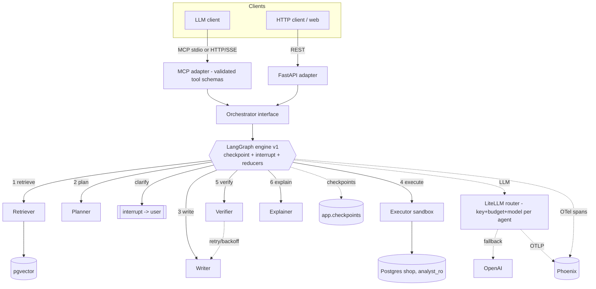
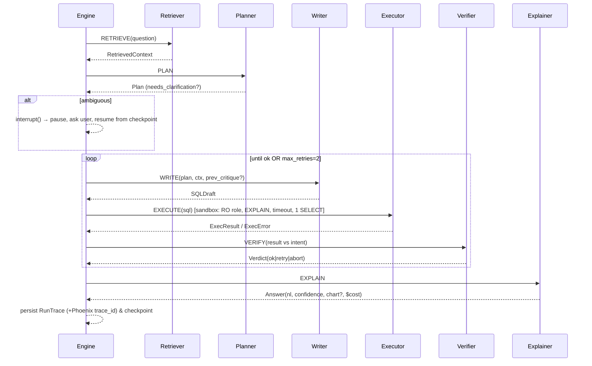

# nl2sql-agent-harness — Multi-agent Text-to-SQL Analytics Agent (plan)

> **This is the original design doc — a record of the plan, not the current-state reference.**
> Two things were implemented differently from what's written below: the provider fallback is
> **Claude-only** (cross-tier Sonnet↔Haiku), not Claude→OpenAI (we run with a single Anthropic key),
> and **per-key model timeouts** were added. For current behaviour see
> [ENGINEERING.md §4](ENGINEERING.md#4-timeouts--fallback-resilience-at-the-model-layer).

## Context

Hrithik (Senior Platform Engineer @ MoEngage, 5 yrs) has an **empty public GitHub** and is
interviewing for remote **mid-level agent-engineering** roles (incl. Astoria AI). A portfolio
project can't fake real users — so its job is to make him **fluent on what these roles actually
grade**: eval coverage (esp. **evals-in-CI**), **model routing**, **token budgets / cost
awareness**, **tool-schema validation & permission scoping**, **cascading-failure handling**, and
**monitoring** — the "production agent" bar. Hand-rolling a loop gives none of that; **LangGraph
(checkpointing / interrupts / state reducers)** is the production story.

**Project:** `nl2sql-agent-harness` (package `nl2sql`) — a **multi-agent Text-to-SQL analytics
agent** over an e-commerce/logistics Postgres DB, built to demonstrate every gradable competency above.

### Mid-level grading criteria → coverage
| Graded | Covered by |
|---|---|
| Eval beyond manual review | Categorized labeled set (simple/join/aggregate/time/ambiguous/**failure cases**); execution-match + valid-SQL + retries + $/query; optional LLM-as-judge for Explainer |
| **Evals in CI** | `make eval` runs in GitHub Actions via **cassettes** (deterministic, no key), **gated on a regression threshold** |
| Model routing | LiteLLM router, **model per agent** (Planner/Verifier=Sonnet, Writer/Explainer=Haiku), config-swappable |
| Token budgets / cost | Per-agent LiteLLM **key budgets + rate limits**; per-run token/cost cap; **$/query in scorecard + Phoenix** |
| Tool schema validation | MCP + agent tools = strict **Pydantic/JSON-Schema** inputs; malformed rejected |
| Tool permissions/scoping | **Permission matrix**: `get_schema` read; `ask` safe default; `run_sql` sandboxed + off-by-default/elevated; per-client auth on MCP-HTTP; DB = `analyst_ro` |
| Cascading-failure handling | Bounded retries + backoff; **provider fallback** (Claude→OpenAI); stage timeouts; errors → structured critique → graceful low-confidence abort; fail-closed on writes |
| Monitoring | Phoenix: latency, cost, retry/error rate, eval trend, per-agent spans |
| "Name a failure mode you hit" | README **Failure modes & mitigations**, each with a reproducing eval case |

### Locked decisions
- **Repo:** `nl2sql-agent-harness` (package `nl2sql`), public at `github.com/hrithik-personal` (public → GitHub Actions free).
- **Domain:** custom **e-commerce/logistics**; **Faker + fixed seed** (deterministic).
- **Agents (roles):** **Planner → Writer → Verifier → Explainer** + Writer↔Verifier loop.
- **DB:** **Postgres 16** (Docker); `shop` (target, read-only role) + `app` (embeddings, traces, **LangGraph checkpoints**).
- **Vector store:** **pgvector**. **Embeddings:** `BAAI/bge-small-en-v1.5` (pluggable).
- **LLM:** one Anthropic key behind **LiteLLM proxy**; **virtual key + budget + model per agent** (routing); **cassette layer** for offline CI/evals; **OpenAI fallback**.
- **Orchestration:** **pluggable behind an `Orchestrator` interface.** v1 = **LangGraph** using **checkpointing (PostgresSaver), interrupts (clarify), state reducers**; hand-written state-machine = later comparison drop-in (won't get those features free — that's the point).
- **Observability (AIOps = A):** **OpenTelemetry → OTLP → Arize Phoenix**; LiteLLM (per-agent) + OpenInference (LangGraph) spans + our non-LLM spans.
- **Surfaces:** library core; **MCP over stdio + Streamable HTTP/SSE** + **FastAPI** (thin adapters, shared core, co-hostable ASGI); Streamlit UI.
- **Evals:** cassette-based, **run in CI, gated on threshold** (reverses earlier "not a gate").
- **Optional kept:** clarifying interrupt, chart output, OpenAI fallback.

---

## Architecture





---

## Components

**Agentic spine**
1. **Orchestrator (pluggable)** — `Orchestrator` Protocol; v1 = **LangGraph** `StateGraph` (nodes=agents; Writer↔Verifier = conditional edge; **checkpointer=PostgresSaver**; clarify=**interrupt**; accumulators via **reducers** `Annotated[list, add]`); later = hand-written engine. Agents framework-free `(state)->state'`.
2. **Planner** — question → structured **intent** + candidate tables/joins; triggers clarify **interrupt** when ambiguous.
3. **Writer** — Plan + retrieved schema + exemplars (+ prior critique) → structured `SQLDraft`; sqlglot post-process.
4. **Executor (sandbox)** — confined read-only SELECT runner (below).
5. **Verifier + loop** — heuristics + LLM check result-sanity vs intent → `ok|retry|abort` + critique; bounded `max_retries=2`, counted in state.
6. **Explainer** — result → NL answer + confidence + optional chart; SQL as citation; surfaces run cost.

**Retrieval (deterministic, non-agent)**
7. **Schema catalog** — introspection → per-table "cards"; refresh via `make index`.
8. **Retriever** — pgvector similarity over cards + **exemplars** (NL→SQL) + FK expansion; returns relevant subset. (Agentic-RAG = stretch.)

**Surfaces (thin adapters, validated tool schemas)**
9. **MCP** (stdio + Streamable HTTP/SSE) — `get_schema`, `run_sql`, `ask` with Pydantic input schemas + **permission scoping**.
10. **FastAPI** — `/ask`, `/run_sql`, `/schema`; MCP-HTTP mountable on same ASGI.
11. **Streamlit** — answer/SQL/table/chart/confidence/cost/trace + clarify branch (calls FastAPI).

**Quality / platform**
12. **Eval harness** — categorized labeled set incl. failure cases; execution-match + valid-SQL + retries + **$/query**; scorecard + `evals/report.md`; **runs in CI (cassettes), gated on threshold**; optional LLM-as-judge.
13. **Observability/monitoring** — OTel→OTLP→Phoenix; LiteLLM + OpenInference + custom spans; thin `RunTrace` in `app.run_traces` (+trace_id).
14. **Cost & routing** — LiteLLM router: model + budget + rate-limit **per agent**; per-run cost cap; **`$/query`** (a cost metric = LLM spend per question, from tokens×price; not an endpoint) surfaced in trace + scorecard.
15. **Infra** — LiteLLM proxy; `llm.py` (Claude default, OpenAI fallback) + cassette; Docker/compose; CI; tests; README (incl. Failure Modes).

---

## Functional requirements (delta from components)
FR-1..FR-13 as before, plus:
- **FR-5 Executor** — `analyst_ro` (SELECT/USAGE only) + read-only txn + `statement_timeout` + row cap + **`EXPLAIN` pre-flight** (reject invalid or over-cost); structured errors.
- **FR-8 Orchestrator** — LangGraph engine w/ checkpointing + interrupts + reducers behind the interface; global caps (retries/wall-clock/**token+cost budget**); deterministic (seed, temp=0).
- **FR-9 Evals** — categorized set (incl. failure cases); execution-match scorecard w/ $/query; **CI-gated via cassettes**.
- **FR-14 Tool contracts** — every MCP/agent tool has a validated Pydantic/JSON-Schema input; a documented **permission matrix**; `run_sql` off-by-default/elevated; MCP-HTTP per-client auth.
- **FR-15 Resilience** — retry w/ backoff; **provider fallback**; stage timeouts; graceful degradation (low-confidence abort, never crash); fail-closed on writes.
- **FR-16 Cost/routing** — per-agent model + budget + rate limit; per-run cost cap; cost surfaced.

---

## Tech design (key points; unchanged items omitted)
- **Python 3.11+**, Pydantic (structured outputs + typed state + **tool input schemas**).
- **LLM:** LiteLLM proxy; `litellm/config.yaml` defines **per-agent virtual keys → model + budget + rpm limit** (router). `llm.py` = single choke point: `complete(messages, schema, agent)` routing via LiteLLM + Pydantic structured outputs + **cassette** (`LLM_MODE`: **live**=real, no cassette; **record**=real + save fixture; **replay**=cassette-only, miss errors) + cost/token accounting. LangGraph nodes call `llm.py` (NOT LangChain model wrappers — keeps keys/budgets/routing/fallback/cassettes in one place, engine-agnostic). **Fallback** Claude→OpenAI via LiteLLM router.
- **Resilience ownership (who handles what):** semantic retry (verifier) = our conditional edge (bounded by `retry_count`); transient-error retry + backoff = LangGraph **`RetryPolicy`** on nodes; provider fallback = **LiteLLM router**; per-call timeouts = our code + LiteLLM; total-run bound = LangGraph `recursion_limit` + `max_retries`. Unhandled node exception → LangGraph stops *that* run and propagates, but checkpointer persists state → **resumable** by `thread_id`; surfaces return a clean error, server/other runs unaffected.
- **Orchestration:** `nl2sql/orchestration/{base,langgraph_engine,state_machine_engine}.py`.
  **LangGraph primitives we use:** `StateGraph`; typed state = `RunState`; **reducers** (`Annotated[list, operator.add]`) so `sql_drafts/verdicts/trace` **append** across the loop (not overwrite); **nodes** = agents `(state)->partial update`; **conditional edge** for the ok/retry/abort decision; **PostgresSaver checkpointer** (one `thread_id` per run, in `app`) for durability/resume; **`interrupt()` + `Command(resume=…)`** for the clarify flow; **`recursion_limit`** as a hard step cap; `.stream()` for the Streamlit trace. (Our `Orchestrator` Protocol is a *separate* seam — reducers are LangGraph state; the interface is our abstraction.)
  **LangChain built-ins skipped on purpose:** prebuilt agents (`create_react_agent`, `ToolNode`) and model+tool wrappers — we keep LLM access + tool exec/validation in our own code.
- **Embeddings/pgvector/DB/sqlglot/sandbox/Phoenix/surfaces/UI** — as prior version (sqlglot rejects any DML/DDL incl. CTE-hidden; EXPLAIN not ANALYZE; read-only txn; stdio+HTTP MCP mountable on FastAPI).

### Repo layout
```
nl2sql-agent-harness/
  app/streamlit_app.py
  nl2sql/
    config.py schemas.py llm.py catalog.py retrieve.py executor.py telemetry.py resilience.py
    agents/{planner,writer,verifier,explainer}.py
    orchestration/{base,langgraph_engine,state_machine_engine}.py
    tools/{contracts.py, permissions.py}      # validated schemas + permission matrix
  api/main.py            mcp_server/server.py
  db/{schema.sql, roles.sql, seed.py}         # shop DDL + analyst_ro + Faker seed; app: pgvector, run_traces, checkpoints
  evals/{dataset.jsonl, run_evals.py, judge.py, report.md}
  tests/ (+ tests/cassettes/)
  litellm/config.yaml
  docker-compose.yml Dockerfile .github/workflows/ci.yml
  README.md (+ FAILURE_MODES) .env.example Makefile pyproject.toml
```

### Design trade-offs (recorded)
1. **LangGraph primary** (checkpoint/interrupt/reducers = production features), pluggable interface; hand-written engine = learning/comparison (loses those features — the lesson).
2. Multi-agent (accuracy + targeted retries) vs cost → bounded + model routing.
3. pgvector (one datastore). 4. Execution-match evals. 5. Local bge-small (pluggable).
6. MCP(stdio+HTTP)+FastAPI, thin adapters. 7. Deterministic retrieve-then-plan v1; agentic RAG stretch.
8. TraceStep + Phoenix (complementary). 9. Evals in CI via cassettes (deterministic gate).

---

## Failure modes & mitigations (README section + eval cases)
- Hallucinated column/table → EXPLAIN error + Verifier → retry.
- Join fan-out / cartesian → EXPLAIN cost gate → reject/retry.
- Over-filtered empty result → Verifier "empty-when-expected" → retry.
- Ambiguous question → clarify **interrupt**.
- Retry budget exhausted → graceful low-confidence abort.
- LLM provider error/timeout → backoff + **provider fallback**.
- Stacked/CTE-hidden write attempt → sqlglot AST reject + RO role + RO txn (defense in depth).
- Cost spike → per-agent budget + per-run cap trip → abort with message.

---

## Build sequence (phased — larger than one weekend)
**Phase 1 — demoable core (~a weekend).** **Dataset (owned build task):** author `shop` DDL (`db/schema.sql`) + **Faker deterministic seed** (`db/seed.py`) — nothing to procure externally. Then compose: Postgres (`shop`+`app`, `analyst_ro`, seed) + LiteLLM + Phoenix; catalog + pgvector retrieval + a starter set of exemplars; `llm.py` (LiteLLM+cassette); the 4 agents; **LangGraph engine** (conditional-edge retry, reducers) + thin trace; executor sandbox; FastAPI `/ask` + Streamlit. Checkpoint: end-to-end live, self-corrects, spans in Phoenix. *(This is the version to show Astoria if time-pressed.)*
**Phase 2 — the gradable production layer (~3–5 days).** Author **eval dataset** (`evals/dataset.jsonl`, NL→gold-SQL incl. failure cases) + record cassettes; LangGraph **checkpointing + interrupt** (clarify, resumable); **model routing + per-agent budgets**; **tool contracts + permission matrix**; **resilience** (fallback/backoff/timeouts/graceful abort); **eval harness** (categorized + failure cases + $/query) **wired into CI, gated**; MCP (stdio + Streamable HTTP) w/ auth; README + FAILURE_MODES; Loom.
**Phase 3 — polish/stretch.** Hand-written `state_machine_engine` (comparison); agentic-RAG toggle; LLM-as-judge.

## Quickstart (README)
```bash
git clone … && cd nl2sql-agent-harness && cp .env.example .env
docker compose up -d        # Postgres(shop+app) + LiteLLM + Phoenix
make index                  # catalog + embeddings
make api / make run / make mcp   # FastAPI / Streamlit / MCP (make mcp-http for HTTP)
make eval                   # scorecard + evals/report.md (also runs in CI)
make test
```

## Verification (end-to-end)
- Ask across categories → correct SQL, table, chart, confidence, cost, trace w/ retries.
- Ambiguous question → clarify interrupt pauses + resumes from checkpoint.
- Safety: delete/update refused; CTE-hidden DML rejected; EXPLAIN rejects over-broad; RO role can't mutate.
- Kill the primary model key → **provider fallback** keeps it working.
- `make eval` scorecard w/ execution-match + $/query; **CI fails if below threshold**.
- Phoenix shows per-agent spans, cost, retry rate.
- MCP `ask` over stdio + HTTP; FastAPI `/ask` via curl; `run_sql` blocked without scope.
- `pytest` green (unit + cassette).

## Open items (non-blocking — external unknowns only)
- Your Anthropic (+ optional OpenAI) API keys — needed only for live runs / recording cassettes.
- CI eval threshold value — set after the first baseline eval run.
(The dataset is NOT open — schema + Faker seed are a Phase-1 task, eval set a Phase-2 task; we generate both.)
```
